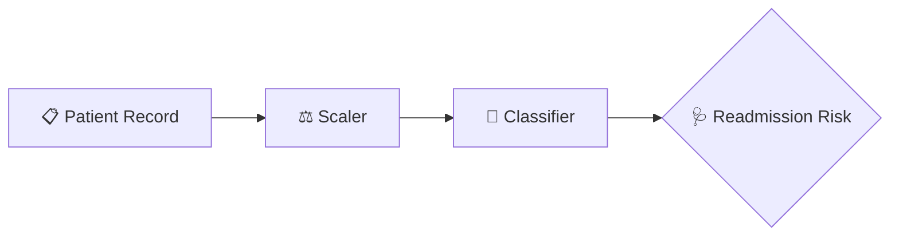

<div align="center">


<b><i>Predict patient readmission risk from records</i></b>


    

   
</div>

---

## 🩺 About the Project

Uses **patient records** to predict the risk of **hospital readmission**. A scaled, trained scikit-learn model is served through Flask so clinicians can enter patient details and get an instant risk assessment — helping hospitals plan follow-up care.

## ✨ Key Features

- 📋 Trained on `hospital_readmission.csv`
- ⚖️ Feature scaling with `scaler.pkl`
- 🤖 Classification model (`model.pkl`) — retrain via `model.py`
- ⚡ Instant readmission **risk prediction**

## 🧠 How It Works



## 🛠️ Tech Stack

| Layer | Technology |
|---|---|
| Language | Python 3 |
| ML | scikit-learn · Pandas · NumPy |
| Web | Flask |

## 📂 Project Structure

```text
PATIENT-RECORDS/
├── app.py
├── model.py
├── hospital_readmission.csv
├── model.pkl
└── scaler.pkl
```

## 🚀 Getting Started

```bash
git clone https://github.com/PreciousBharath/PATIENT-RECORDS.git
cd PATIENT-RECORDS
pip install flask pandas numpy scikit-learn
python app.py
```

## 🤝 Contributing

Contributions, issues and feature requests are welcome! Feel free to ⭐ star the repo and open a pull request.

## 👨‍💻 Author

<div align="center">

**Bharath** — Software Developer · Project Engineer · Technical Trainer

<a href="https://github.com/PreciousBharath"></a>
<a href="https://linkedin.com/in/connectbharath"></a>

### 🍔 EAT · 😴 SLEEP · 💻 CODE · 🔁 REPEAT

⭐ **If you found this project useful, give it a star!** ⭐


</div>
